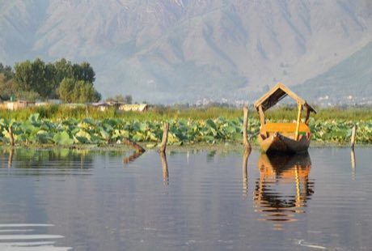

# Shikara paddle race

*Also known as: shikara*

**Encyclopedia ID 265** (permanent) · https://bpupadhyaya.github.io/world-heritage-games-site/games/265-shikara-paddle-race/

*Photo: Fulvio Spada from Torino, Italy, [CC BY-SA 2.0](https://creativecommons.org/licenses/by-sa/2.0/), [source on Wikimedia Commons](https://commons.wikimedia.org/wiki/File:Empty_shikara_on_Dal_Lake%2C_Srinagar%2C_India_2013-08-23_%28flickr_9967093983%29.jpg)*

Paddle a long, shallow boat through lily-pad and houseboat lanes to deliver goods before the light fades.

## Heritage note

Part of the living heritage of India.

## Origins

Usually placed in the era of Age of Contact and Craft (about 1500 to 1800), although its exact origins are uncertain, within the cultural world of South Asia.

## Facts

- **Where:** India
- **Type:** Racing
- **Family:** Water sports
- **Era:** [Age of Contact and Craft](../../eras/contact/index.md) (uncertain)
- **Cradle:** [South Asia](../../cradles/south-asia/index.md)
- **Region:** South and Central Asia

## Related entries

- [Nouka Baich](../../games/42-nouka-baich/index.md)
- [Pirogue coastal canoe race](../../games/56-pirogue-coastal-canoe-race/index.md)
- [Nile Felucca Sailing](../../games/216-nile-felucca-sailing/index.md)
- [Hanetsuki](../../games/347-hanetsuki/index.md)
- [Venetian lagoon regatta](../../games/486-venetian-lagoon-regatta/index.md)
- [Ngalawa outrigger sailing](../../games/1259-ngalawa-outrigger-sailing/index.md)

## Sources

- <https://commons.wikimedia.org/wiki/File:Empty_shikara_on_Dal_Lake%2C_Srinagar%2C_India_2013-08-23_%28flickr_9967093983%29.jpg>
