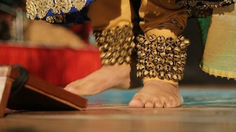

# Kathak tatkar footwork rhythm

*Also known as: tatkar, ghungroo*

**Encyclopedia ID 267** (permanent) · https://bpupadhyaya.github.io/world-heritage-games-site/games/267-kathak-tatkar-footwork-rhythm/

*Photo: RaniJhansi0310, [CC BY-SA 4.0](https://creativecommons.org/licenses/by-sa/4.0/), [source on Wikimedia Commons](https://commons.wikimedia.org/wiki/File:Kathak_Tatkar.jpg)*

Stamp feet to a cycle of beats shown by a tabla loop while bells ring and the rhythm speeds up in steps.

## Heritage note

Part of the living heritage of India, Pakistan.

## Origins

A living tradition passed from person to person; it is not tied to a single dated origin. It belongs to the cultural world of South Asia.

## Facts

- **Where:** India, Pakistan
- **Type:** Other traditions
- **Era:** [Living Traditions](../../eras/living/index.md) (uncertain)
- **Cradle:** [South Asia](../../cradles/south-asia/index.md)
- **Region:** South and Central Asia

## Related entries

- [Pakistani truck art](../../games/116-pakistani-truck-art/index.md)
- [Warli painting](../../games/117-warli-painting/index.md)
- [Block printing](../../games/118-block-printing/index.md)
- [Santoor](../../games/151-santoor/index.md)
- [Phulkari darn-stitch embroidery](../../games/257-phulkari-darn-stitch-embroidery/index.md)
- [Bandhani tie-dye](../../games/258-bandhani-tie-dye/index.md)

## Sources

- <https://commons.wikimedia.org/wiki/File:Kathak_Tatkar.jpg>
