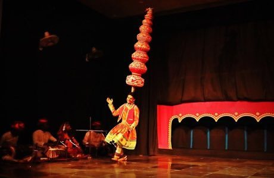

# Bhavai pot-balance dance

*bhavai · Bhavai dance*

**Encyclopedia ID 268** (permanent) · https://equalinformation.com/world-heritage-games-site/games/268-bhavai-pot-balance-dance/

*Photo: Jmadhu, [CC BY-SA 4.0](https://creativecommons.org/licenses/by-sa/4.0/), [source on Wikimedia Commons](https://commons.wikimedia.org/wiki/File:MadhuJagdhish_Bhavai_Dance_1.jpg)*

Balance a growing stack of earthen pots on the head while stepping and turning to the music without letting the tower fall.

## Heritage note

Part of the living heritage of India. Some forms of this practice carry deep meaning for the communities who keep it; here we describe the play and the craft only, with respect for its roots.

## Origins

Usually placed in the era of Modern Heritage (1800 to today), although its exact origins are uncertain, within the cultural world of South Asia.

## Facts

- **Where:** India
- **Type:** Dexterity and skill games
- **Family:** Winter sports
- **Era:** [Modern Heritage](../../eras/modern/index.md) (uncertain)
- **Cradle:** [South Asia](../../cradles/south-asia/index.md)
- **Region:** South and Central Asia

## Related entries

- [Indian club swinging](../../games/264-indian-club-swinging/index.md)
- [Chinlone](../../games/16-chinlone/index.md)
- [Pinata swing](../../games/61-pinata-swing/index.md)
- [Ring Tilting](../../games/65-ring-tilting/index.md)
- [Yukigassen Snow Fort](../../games/71-yukigassen-snow-fort/index.md)
- [Bagatelle](../../games/72-bagatelle/index.md)

## Sources

- <https://commons.wikimedia.org/wiki/File:MadhuJagdhish_Bhavai_Dance_1.jpg>
- <https://en.wikipedia.org/wiki/Bhavai_dance>
