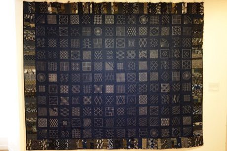

# Sashiko Stitch Patterns

*Sashiko*

**Encyclopedia ID 27** (permanent) · https://equalinformation.com/world-heritage-games-site/games/27-sashiko-stitch-patterns/

*Photo: Daderot, [CC0](https://creativecommons.org/publicdomain/zero/1.0/), [source on Wikimedia Commons](https://commons.wikimedia.org/wiki/File:Sashiko_by_volunteers,_2012_-_Textile_Museum_of_Canada_-_DSC00807.JPG)*

Trace running-stitch routes across a dotted cloth grid to complete geometric patterns (asanoha, seigaiha, etc.) without lifting the thread or doubling a stitch.

## Heritage note

Part of the living heritage of Japan.

## Origins

A living tradition passed from person to person; it is not tied to a single dated origin. It belongs to the cultural world of Japan and Korea.

## Facts

- **Where:** Japan
- **Type:** Crafts and making
- **Family:** Textile and weaving crafts
- **Era:** [Living Traditions](../../eras/living/index.md)
- **Cradle:** [Japan and Korea](../../cradles/japan-korea/index.md)
- **Region:** East and Southeast Asia

## Related entries

- [Kente strip weaving](../../games/22-kente-strip-weaving/index.md)
- [Celtic knot weave](../../games/25-celtic-knot-weave/index.md)
- [Adire indigo resist dyeing](../../games/87-adire-indigo-resist-dyeing/index.md)
- [Agaseke basket weaving](../../games/89-agaseke-basket-weaving/index.md)
- [Toquilla straw hat weaving](../../games/93-toquilla-straw-hat-weaving/index.md)
- [Cross-Stitch Pattern Weaving](../../games/103-cross-stitch-pattern-weaving/index.md)

## Sources

- <https://commons.wikimedia.org/wiki/File:Sashiko_by_volunteers,_2012_-_Textile_Museum_of_Canada_-_DSC00807.JPG>
