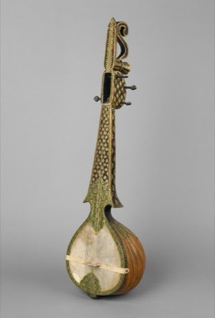

# Rabab plucked lute

*Also known as: rabab (rubab)*

**Encyclopedia ID 270** (permanent) · https://bpupadhyaya.github.io/world-heritage-games-site/games/270-rabab-plucked-lute/

*Photo: Unnamed photographer, released into public domain by Metropo, [CC0](https://creativecommons.org/publicdomain/zero/1.0/), [source on Wikimedia Commons](https://commons.wikimedia.org/wiki/File:Rabab_ca._1885_Indian_%28north%29%2C_Metropolitan_Museum_of_Art.jpg)*

Pluck and strum the strings of a skin-faced lute following scrolling notes in drone-and-melody patterns.

## Heritage note

Part of the living heritage of India, Pakistan.

## Origins

Usually placed in the era of Crossroads and Golden Ages (about 500 to 1500), although its exact origins are uncertain, within the cultural world of South Asia.

## Facts

- **Where:** India, Pakistan
- **Type:** Musical instruments
- **Family:** String instruments
- **Era:** [Crossroads and Golden Ages](../../eras/crossroads/index.md) (uncertain)
- **Cradle:** [South Asia](../../cradles/south-asia/index.md)
- **Region:** South and Central Asia

## Related entries

- [Veena](../../games/282-veena/index.md)
- [Dombra](../../games/48-dombra/index.md)
- [Charango](../../games/55-charango/index.md)
- [Kathputli string puppets](../../games/79-kathputli-string-puppets/index.md)
- [Erhu Two-String Fiddle](../../games/139-erhu-two-string-fiddle/index.md)
- [Santoor](../../games/151-santoor/index.md)

## Sources

- <https://commons.wikimedia.org/wiki/File:Rabab_ca._1885_Indian_%28north%29%2C_Metropolitan_Museum_of_Art.jpg>
