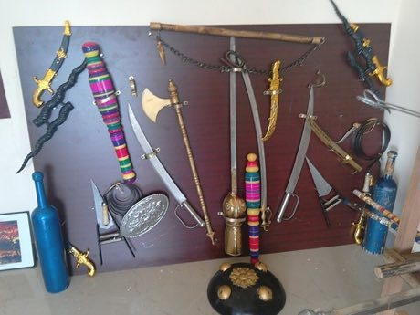

# Silambam

*சிலம்பம் · bamboo staff fencing*

**Encyclopedia ID 271** (permanent) · https://equalinformation.com/world-heritage-games-site/games/271-silambam/

*Photo: Arunachalam Mani, [CC BY-SA 4.0](https://creativecommons.org/licenses/by-sa/4.0/), [source on Wikimedia Commons](https://commons.wikimedia.org/wiki/File%3AWeapons_images_of_Silambam.jpg)*

Two fencers circle with long bamboo staffs, scoring touches with strikes, blocks and footwork patterns.

## Heritage note

Part of the living heritage of India. Some forms of this practice carry deep meaning for the communities who keep it; here we describe the play and the craft only, with respect for its roots.

## Origins

Usually placed in the era of Classical Worlds (about 1000 BCE to 500 CE), although its exact origins are uncertain, within the cultural world of South Asia.

## Facts

- **Where:** India
- **Type:** Wrestling and martial sports
- **Era:** [Classical Worlds](../../eras/classical/index.md) (uncertain)
- **Cradle:** [South Asia](../../cradles/south-asia/index.md)
- **Region:** South and Central Asia

## Related entries

- [Kathputli string puppets](../../games/79-kathputli-string-puppets/index.md)
- [Kite fighting](../../games/788-kite-fighting/index.md)
- [Kotta Pora](../../games/18-kotta-pora/index.md)
- [Stilt fishing](../../games/288-stilt-fishing/index.md)
- [Murchunga](../../games/290-murchunga/index.md)
- [Lathi Khela](../../games/298-lathi-khela/index.md)

## Sources

- <https://commons.wikimedia.org/wiki/File%3AWeapons_images_of_Silambam.jpg>
