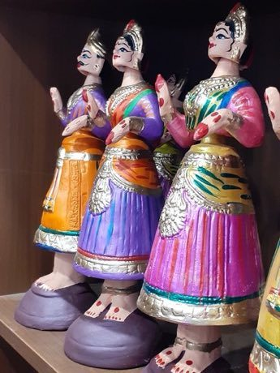

# Thanjavur dancing doll

*Also known as: தஞ்சாவூர் தலையாட்டி பொம்மை · balancing toy*

**Encyclopedia ID 275** (permanent) · https://bpupadhyaya.github.io/world-heritage-games-site/games/275-thanjavur-dancing-doll/

*Photo: Sindugab, [CC BY-SA 4.0](https://creativecommons.org/licenses/by-sa/4.0/), [source on Wikimedia Commons](https://commons.wikimedia.org/wiki/File%3AThanjavur_Dancing_Dolls.jpg)*

Tip, stack and tune the weighted round-bottom dolls so they sway gracefully and settle upright; match sway patterns.

## Heritage note

Part of the living heritage of India. Some forms of this practice carry deep meaning for the communities who keep it; here we describe the play and the craft only, with respect for its roots.

## Origins

Usually placed in the era of Modern Heritage (1800 to today), although its exact origins are uncertain, within the cultural world of South Asia.

## Facts

- **Where:** India
- **Type:** Toys
- **Family:** Puzzle and dexterity toys
- **Era:** [Modern Heritage](../../eras/modern/index.md) (uncertain)
- **Cradle:** [South Asia](../../cradles/south-asia/index.md)
- **Region:** South and Central Asia

## Play it

[Web preview](https://bpupadhyaya.github.io/) · [Google Play](https://play.google.com/store/apps/details?id=com.equalinformation.arcforge.shell) · [App Store](https://apps.apple.com/us/app/arcforge-world-heritage-games/id6813746442)

## Related entries

- [Chungi](../../games/297-chungi/index.md)
- [Stone put](../../games/589-stone-put/index.md)
- [Dandi Biyo](../../games/968-dandi-biyo/index.md)
- [Break the pot](../../games/1105-break-the-pot/index.md)
- [Hill-country tea plucking](../../games/1297-hill-country-tea-plucking/index.md)
- [Dego](../../games/590-dego/index.md)

## Sources

- <https://commons.wikimedia.org/wiki/File%3AThanjavur_Dancing_Dolls.jpg>
