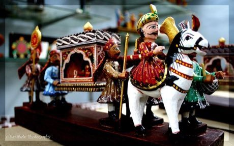

# Kondapalli village toys

*Also known as: కొండపల్లి బొమ్మలు*

**Encyclopedia ID 276** (permanent) · https://bpupadhyaya.github.io/world-heritage-games-site/games/276-kondapalli-village-toys/

*Photo: Balamurugan Natarajan from chennai, India, [CC BY 2.0](https://creativecommons.org/licenses/by/2.0/), [source on Wikimedia Commons](https://commons.wikimedia.org/wiki/File%3AKondapalli_Toys_%283404488827%29.jpg)*

Carve and paint soft-wood figures to compose a village scene from a bullock cart, palanquin and market folk.

## Heritage note

A tradition shared by communities in many places.

## Origins

A living tradition passed from person to person; it is not tied to a single dated origin.

## Facts

- **Where:** Shared across many places
- **Type:** Crafts and making
- **Family:** Pottery, wood and metal crafts
- **Era:** [Living Traditions](../../eras/living/index.md)
- **Cradle:** [Shared across the world](../../cradles/worldwide/index.md)
- **Region:** Worldwide

## Related entries

- [Zellij tile mosaic](../../games/21-zellij-tile-mosaic/index.md)
- [Thai fruit and vegetable carving](../../games/114-thai-fruit-and-vegetable-carving/index.md)
- [Glassblowing](../../games/121-glassblowing/index.md)
- [Azulejo tile painting](../../games/122-azulejo-tile-painting/index.md)
- [Krobo Powder-Glass Beads](../../games/173-krobo-powder-glass-beads/index.md)
- [Lost-Wax Bronze Casting](../../games/178-lost-wax-bronze-casting/index.md)

## Sources

- <https://commons.wikimedia.org/wiki/File%3AKondapalli_Toys_%283404488827%29.jpg>
