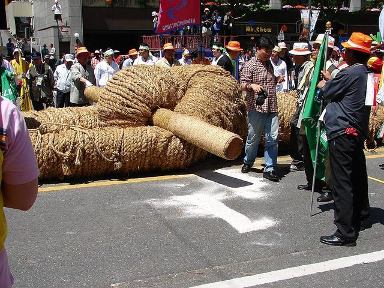

# Juldarigi

*Also known as: Korean: 줄다리기 · also chuldarigi · Tug of war · Rope pulling*

**Encyclopedia ID 2772** (permanent) · https://bpupadhyaya.github.io/world-heritage-games-site/games/2772-juldarigi/

*Photo: Steve46814 at English Wikipedia, [CC BY-SA 3.0](https://creativecommons.org/licenses/by-sa/3.0/), [source on Wikimedia Commons](https://commons.wikimedia.org/wiki/File:Korea-Hi_Seoul_Festival-2006-09.jpg)*

Tug of war, two teams pulling on one rope, is among the oldest contests of strength and is played at village festivals from Korea and Japan to Britain and Indonesia; several Asian rope-pulling festivals are listed as living heritage.

## How it is played

Teams grip the rope on either side of a centre mark and pull in time to a caller; the side that drags the mark past its own line wins. Rhythm, footing and holding the surge matter as much as weight.

## Heritage note

Part of the living heritage of South Korea, United Kingdom, Indonesia.

## Origins

Usually placed in the era of Classical Worlds (about 1000 BCE to 500 CE), although its exact origins are uncertain, within the cultural world of Japan and Korea.

## Facts

- **Where:** South Korea, United Kingdom, Indonesia
- **Type:** Other traditions
- **Era:** [Classical Worlds](../../eras/classical/index.md) (uncertain)
- **Cradle:** [Japan and Korea](../../cradles/japan-korea/index.md)
- **Region:** East and Southeast Asia
- **Players:** 2 teams

## Play it

[Try a 90-second preview in your browser](https://bpupadhyaya.github.io/games-site/games/tug-of-war-rope/play/) · [Google Play](https://play.google.com/store/apps/details?id=com.equalinformation.arcforge.shell) · [App Store](https://apps.apple.com/us/app/arcforge-world-heritage-games/id6813746442)

## Related entries

- [Gayageum](../../games/361-gayageum/index.md)
- [Baduk](../../games/1084-baduk/index.md)
- [Geomungo](../../games/1453-geomungo/index.md)
- [Omok](../../games/1088-omok/index.md)
- [Ttakji-ssaum](../../games/14067-ttakji-ssaum/index.md)
- [Shakuhachi](../../games/349-shakuhachi/index.md)

## Sources

- <https://en.wikipedia.org/wiki/Juldarigi>
- <https://en.wikipedia.org/wiki/Tug_of_war>
