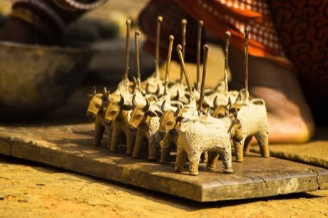

# Dhokra lost-wax casting

*ଢୋକରା*

**Encyclopedia ID 278** (permanent) · https://bpupadhyaya.github.io/world-heritage-games-site/games/278-dhokra-lost-wax-casting/

*Photo: Government of Odisha, [CC BY 4.0](https://creativecommons.org/licenses/by/4.0/), [source on Wikimedia Commons](https://commons.wikimedia.org/wiki/File%3ADhokra_figurines_by_Dharua_women_of_Odisha.jpg)*

Coil wax threads into a figure, coat in clay, melt out the wax and pour metal, choosing steps in order.

## Heritage note

Part of the living heritage of Bangladesh. Animals are partners in this tradition; good care and local rules always come first.

## Origins

A living tradition passed from person to person; it is not tied to a single dated origin. It belongs to the cultural world of South Asia.

## Facts

- **Where:** Bangladesh
- **Type:** Crafts and making
- **Family:** Pottery, wood and metal crafts
- **Era:** [Living Traditions](../../eras/living/index.md)
- **Cradle:** [South Asia](../../cradles/south-asia/index.md)
- **Region:** South and Central Asia

## Related entries

- [Bankura terracotta horse](../../games/280-bankura-terracotta-horse/index.md)
- [Sholapith flower carving](../../games/283-sholapith-flower-carving/index.md)
- [Jaipur blue pottery painting](../../games/262-jaipur-blue-pottery-painting/index.md)
- [Ambalangoda mask carving](../../games/299-ambalangoda-mask-carving/index.md)
- [Maldivian lacquer work](../../games/1328-maldivian-lacquer-work/index.md)
- [Zellij tile mosaic](../../games/21-zellij-tile-mosaic/index.md)

## Sources

- <https://commons.wikimedia.org/wiki/File%3ADhokra_figurines_by_Dharua_women_of_Odisha.jpg>
