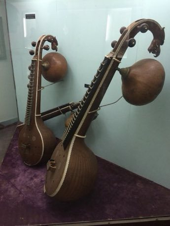

# Veena

*வீணை · South Indian plucked lute*

**Encyclopedia ID 282** (permanent) · https://equalinformation.com/world-heritage-games-site/games/282-veena/

*Photo: Param munde, [CC BY-SA 4.0](https://creativecommons.org/licenses/by-sa/4.0/), [source on Wikimedia Commons](https://commons.wikimedia.org/wiki/File%3ASaraswati_veena_-_Collections_of_the_Government_Museum_%28Bangalore%29-TTT17_%289%29.jpg)*

Pluck strings and slide the finger along frets to play note-by-note melodies and ornaments (gamaka) in guided scales.

## Heritage note

Part of the living heritage of India.

## Origins

Usually placed in the era of Crossroads and Golden Ages (about 500 to 1500), although its exact origins are uncertain, within the cultural world of South Asia.

## Facts

- **Where:** India
- **Type:** Musical instruments
- **Family:** String instruments
- **Era:** [Crossroads and Golden Ages](../../eras/crossroads/index.md) (uncertain)
- **Cradle:** [South Asia](../../cradles/south-asia/index.md)
- **Region:** South and Central Asia

## Related entries

- [Rabab plucked lute](../../games/270-rabab-plucked-lute/index.md)
- [Dombra](../../games/48-dombra/index.md)
- [Charango](../../games/55-charango/index.md)
- [Kathputli string puppets](../../games/79-kathputli-string-puppets/index.md)
- [Erhu Two-String Fiddle](../../games/139-erhu-two-string-fiddle/index.md)
- [Santoor](../../games/151-santoor/index.md)

## Sources

- <https://commons.wikimedia.org/wiki/File%3ASaraswati_veena_-_Collections_of_the_Government_Museum_%28Bangalore%29-TTT17_%289%29.jpg>
