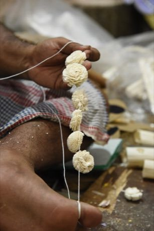

# Sholapith flower carving

*শোলা*

**Encyclopedia ID 283** (permanent) · https://equalinformation.com/world-heritage-games-site/games/283-sholapith-flower-carving/

*Photo: Prakriti Panda, [CC BY-SA 4.0](https://creativecommons.org/licenses/by-sa/4.0/), [source on Wikimedia Commons](https://commons.wikimedia.org/wiki/File%3A6_out_of_8_types_of_traditional_flower_designs_made_out_of_sholapith.jpg)*

Slice thin pith paper into petals and arrange them on wire to build flowers and garlands for a design.

## Heritage note

Part of the living heritage of Bangladesh. Some forms of this practice carry deep meaning for the communities who keep it; here we describe the play and the craft only, with respect for its roots.

## Origins

A living tradition passed from person to person; it is not tied to a single dated origin. It belongs to the cultural world of South Asia.

## Facts

- **Where:** Bangladesh
- **Type:** Crafts and making
- **Family:** Pottery, wood and metal crafts
- **Era:** [Living Traditions](../../eras/living/index.md)
- **Cradle:** [South Asia](../../cradles/south-asia/index.md)
- **Region:** South and Central Asia

## Related entries

- [Dhokra lost-wax casting](../../games/278-dhokra-lost-wax-casting/index.md)
- [Bankura terracotta horse](../../games/280-bankura-terracotta-horse/index.md)
- [Jaipur blue pottery painting](../../games/262-jaipur-blue-pottery-painting/index.md)
- [Ambalangoda mask carving](../../games/299-ambalangoda-mask-carving/index.md)
- [Maldivian lacquer work](../../games/1328-maldivian-lacquer-work/index.md)
- [Zellij tile mosaic](../../games/21-zellij-tile-mosaic/index.md)

## Sources

- <https://commons.wikimedia.org/wiki/File%3A6_out_of_8_types_of_traditional_flower_designs_made_out_of_sholapith.jpg>
