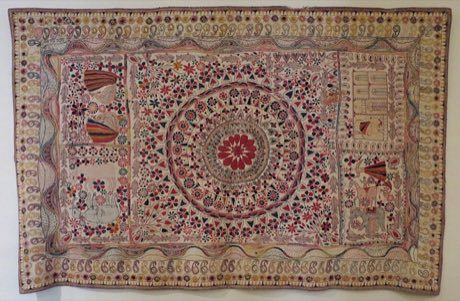

# Kantha running-stitch quilt

*কাঁথা*

**Encyclopedia ID 284** (permanent) · https://equalinformation.com/world-heritage-games-site/games/284-kantha-running-stitch-quilt/

*Photo: Hiart, [CC0](https://creativecommons.org/publicdomain/zero/1.0/), [source on Wikimedia Commons](https://commons.wikimedia.org/wiki/File%3AKantha_%28bed_cover%29_from_Bengal%2C_Honolulu_Museum_of_Art%2C_3983.1.JPG)*

Trace running stitches through layered cloth to build ripples and motifs.

## Heritage note

Part of the living heritage of Bangladesh.

## Origins

A living tradition passed from person to person; it is not tied to a single dated origin. It belongs to the cultural world of South Asia.

## Facts

- **Where:** Bangladesh
- **Type:** Crafts and making
- **Family:** Textile and weaving crafts
- **Era:** [Living Traditions](../../eras/living/index.md)
- **Cradle:** [South Asia](../../cradles/south-asia/index.md)
- **Region:** South and Central Asia

## Related entries

- [Nakshi Kantha embroidery](../../games/294-nakshi-kantha-embroidery/index.md)
- [Jamdani muslin weaving](../../games/1305-jamdani-muslin-weaving/index.md)
- [Shital pati cool mat weaving](../../games/1371-shital-pati-cool-mat-weaving/index.md)
- [Dhaka weave pattern loom](../../games/115-dhaka-weave-pattern-loom/index.md)
- [Phulkari darn-stitch embroidery](../../games/257-phulkari-darn-stitch-embroidery/index.md)
- [Bandhani tie-dye](../../games/258-bandhani-tie-dye/index.md)

## Sources

- <https://commons.wikimedia.org/wiki/File%3AKantha_%28bed_cover%29_from_Bengal%2C_Honolulu_Museum_of_Art%2C_3983.1.JPG>
