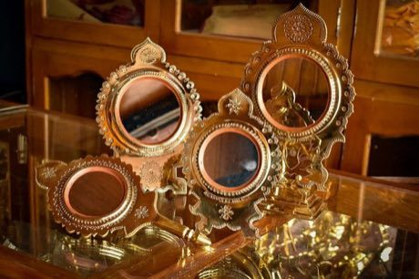

# Aranmula metal mirror

*Also known as: ആറന്മുള കണ്ണാടി*

**Encyclopedia ID 285** (permanent) · https://bpupadhyaya.github.io/world-heritage-games-site/games/285-aranmula-metal-mirror/

*Photo: Prasanth Prakash, [CC BY-SA 4.0](https://creativecommons.org/licenses/by-sa/4.0/), [source on Wikimedia Commons](https://commons.wikimedia.org/wiki/File%3AAranmula_Kannadi.jpg)*

Mix bronze alloy by ratio, cast it, then grind and polish through finer grits until the surface reflects clearly.

## Heritage note

A tradition shared by communities in many places. Some forms of this practice carry deep meaning for the communities who keep it; here we describe the play and the craft only, with respect for its roots.

## Origins

A living tradition passed from person to person; it is not tied to a single dated origin.

## Facts

- **Where:** Shared across many places
- **Type:** Crafts and making
- **Family:** Pottery, wood and metal crafts
- **Era:** [Living Traditions](../../eras/living/index.md)
- **Cradle:** [Shared across the world](../../cradles/worldwide/index.md)
- **Region:** East and Southeast Asia

## Related entries

- [Zellij tile mosaic](../../games/21-zellij-tile-mosaic/index.md)
- [Swahili carved door](../../games/90-swahili-carved-door/index.md)
- [Thai fruit and vegetable carving](../../games/114-thai-fruit-and-vegetable-carving/index.md)
- [Glassblowing](../../games/121-glassblowing/index.md)
- [Azulejo tile painting](../../games/122-azulejo-tile-painting/index.md)
- [Krobo Powder-Glass Beads](../../games/173-krobo-powder-glass-beads/index.md)

## Sources

- <https://commons.wikimedia.org/wiki/File%3AAranmula_Kannadi.jpg>
