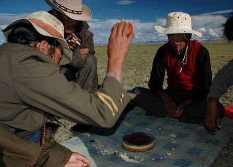

# Sho

*ཤོ · Tibetan dice race*

**Encyclopedia ID 286** (permanent) · https://bpupadhyaya.github.io/world-heritage-games-site/games/286-sho/

*Photo: Moschusochse, [CC BY-SA 3.0](https://creativecommons.org/licenses/by-sa/3.0/), [source on Wikimedia Commons](https://commons.wikimedia.org/wiki/File:Sho.jpg)*

Two to four players throw two dice and race nine coins each around a ring of 64 shells, with captures, blocking and exact-count finishes.

## Heritage note

Part of the living heritage of China. Some forms of this practice carry deep meaning for the communities who keep it; here we describe the play and the craft only, with respect for its roots.

## Origins

Usually placed in the era of River Valleys and First Cities (about 3000 to 1000 BCE), although its exact origins are uncertain, within the cultural world of China.

## Facts

- **Where:** China
- **Type:** Board and table games
- **Family:** Dice and knucklebone games
- **Era:** [River Valleys and First Cities](../../eras/river-valleys/index.md) (uncertain)
- **Cradle:** [China](../../cradles/china/index.md)
- **Region:** East and Southeast Asia

## Related entries

- [Liubo](../../games/331-liubo/index.md)
- [E-sugoroku](../../games/348-e-sugoroku/index.md)
- [Generala](../../games/422-generala/index.md)
- [Game of the Goose](../../games/450-game-of-the-goose/index.md)
- [Sáhkku](../../games/451-sahkku/index.md)
- [Parxís](../../games/542-parxis/index.md)

## Sources

- <https://commons.wikimedia.org/wiki/File:Sho.jpg>
