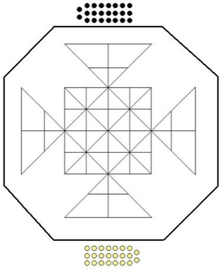

# Peralikatuma

*පෙරලිකටුම*

**Encyclopedia ID 287** (permanent) · https://bpupadhyaya.github.io/world-heritage-games-site/games/287-peralikatuma/

*Photo: unknown (public domain), [Public domain](https://creativecommons.org/publicdomain/mark/1.0/), [source on Wikimedia Commons](https://commons.wikimedia.org/wiki/File:Peralikatuma_board.JPG)*

Two players hop over each other's pieces on a mirrored octagonal-cross board, capturing by jumping, in the manner of draughts but on a star-shaped grid.

## Heritage note

Part of the living heritage of Sri Lanka.

## Origins

Usually placed in the era of Crossroads and Golden Ages (about 500 to 1500), although its exact origins are uncertain, within the cultural world of South Asia.

## Facts

- **Where:** Sri Lanka
- **Type:** Board and table games
- **Family:** Draughts and capture games
- **Era:** [Crossroads and Golden Ages](../../eras/crossroads/index.md) (uncertain)
- **Cradle:** [South Asia](../../cradles/south-asia/index.md)
- **Region:** South and Central Asia

## Related entries

- [Sholo Guti](../../games/461-sholo-guti/index.md)
- [Turkish Dama](../../games/155-turkish-dama/index.md)
- [Yote Capture Grid](../../games/167-yote-capture-grid/index.md)
- [Kharbaga](../../games/459-kharbaga/index.md)
- [Zamma](../../games/462-zamma/index.md)
- [Queah](../../games/885-queah/index.md)

## Sources

- <https://commons.wikimedia.org/wiki/File:Peralikatuma_board.JPG>
