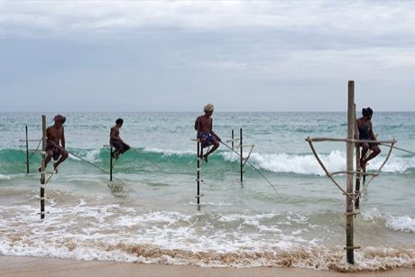

# Stilt fishing

*රිටිපැන්න · Ritipanna*

**Encyclopedia ID 288** (permanent) · https://bpupadhyaya.github.io/world-heritage-games-site/games/288-stilt-fishing/

*Photo: Jakub Hałun, [CC BY 4.0](https://creativecommons.org/licenses/by/4.0/), [source on Wikimedia Commons](https://commons.wikimedia.org/wiki/File:Fishermen_practicing_traditional_stilt_fishing_near_Galle,_southern_Sri_Lanka,_20260207_1419_9448.jpg)*

Perch on a crossbar over the surf, balance against waves, cast a line at the right moment and land fish of different sizes before dusk.

## Heritage note

Part of the living heritage of Sri Lanka.

## Origins

Usually placed in the era of Classical Worlds (about 1000 BCE to 500 CE), although its exact origins are uncertain, within the cultural world of South Asia.

## Facts

- **Where:** Sri Lanka
- **Type:** Dexterity and skill games
- **Family:** Water sports
- **Era:** [Classical Worlds](../../eras/classical/index.md) (uncertain)
- **Cradle:** [South Asia](../../cradles/south-asia/index.md)
- **Region:** South and Central Asia

## Related entries

- [Kotta Pora](../../games/18-kotta-pora/index.md)
- [Nouka Baich](../../games/42-nouka-baich/index.md)
- [Shikara paddle race](../../games/265-shikara-paddle-race/index.md)
- [Pole-and-line tuna fishing from a masdhoni](../../games/1334-pole-and-line-tuna-fishing-from-a-masdhoni/index.md)
- [Horn pulling](../../games/1103-horn-pulling/index.md)
- [Pirogue coastal canoe race](../../games/56-pirogue-coastal-canoe-race/index.md)

## Sources

- <https://commons.wikimedia.org/wiki/File:Fishermen_practicing_traditional_stilt_fishing_near_Galle,_southern_Sri_Lanka,_20260207_1419_9448.jpg>
