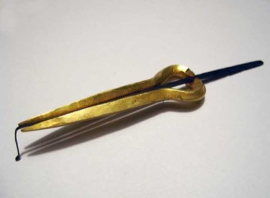

# Murchunga

*मुर्चुङ्गा · Nepali jaw harp*

**Encyclopedia ID 290** (permanent) · https://bpupadhyaya.github.io/world-heritage-games-site/games/290-murchunga/

*Photo: Hillbillywally, [CC BY 3.0](https://creativecommons.org/licenses/by/3.0/), [source on Wikimedia Commons](https://commons.wikimedia.org/wiki/File:Murchunga.jpg)*

Hold the metal frame to the lips and pluck the tongue, shaping notes with the mouth; the game follows melodies by timing plucks and mouth shapes.

## Heritage note

Part of the living heritage of Nepal.

## Origins

Usually placed in the era of Classical Worlds (about 1000 BCE to 500 CE), although its exact origins are uncertain, within the cultural world of South Asia.

## Facts

- **Where:** Nepal
- **Type:** Musical instruments
- **Family:** String instruments
- **Era:** [Classical Worlds](../../eras/classical/index.md) (uncertain)
- **Cradle:** [South Asia](../../cradles/south-asia/index.md)
- **Region:** South and Central Asia

## Related entries

- [Kathputli string puppets](../../games/79-kathputli-string-puppets/index.md)
- [Morin khuur](../../games/34-morin-khuur/index.md)
- [Valiha tube zither](../../games/124-valiha-tube-zither/index.md)
- [Krar lyre](../../games/126-krar-lyre/index.md)
- [Joropo llanero band](../../games/130-joropo-llanero-band/index.md)
- [Kanklės](../../games/136-kankles/index.md)

## Sources

- <https://commons.wikimedia.org/wiki/File:Murchunga.jpg>
