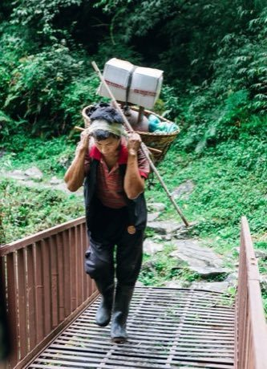

# Doko porter trail

*Also known as: डोको*

**Encyclopedia ID 293** (permanent) · https://bpupadhyaya.github.io/world-heritage-games-site/games/293-doko-porter-trail/

*Photo: Bijay Chaurasia, [CC BY-SA 4.0](https://creativecommons.org/licenses/by-sa/4.0/), [source on Wikimedia Commons](https://commons.wikimedia.org/wiki/File:Doko_carried_by_porters_to_carry_goods_in_Nepal-3069.jpg)*

Carry a loaded basket held by a headstrap up a mountain trail, balancing the load on steps and bridges and resting at the right moments.

## Heritage note

Part of the living heritage of Nepal.

## Origins

Usually placed in the era of Modern Heritage (1800 to today), although its exact origins are uncertain, within the cultural world of South Asia.

## Facts

- **Where:** Nepal
- **Type:** Dexterity and skill games
- **Era:** [Modern Heritage](../../eras/modern/index.md) (uncertain)
- **Cradle:** [South Asia](../../cradles/south-asia/index.md)
- **Region:** South and Central Asia

## Play it

[Try a 90-second preview in your browser](https://bpupadhyaya.github.io/games-site/games/doko-porter-trail/play/) · [Google Play](https://play.google.com/store/apps/details?id=com.equalinformation.arcforge.shell) · [App Store](https://apps.apple.com/us/app/arcforge-world-heritage-games/id6813746442)

## Related entries

- [Kho-Kho](../../games/15-kho-kho/index.md)
- [Chungi](../../games/297-chungi/index.md)
- [Kabaddi](../../games/789-kabaddi/index.md)
- [Dandi Biyo](../../games/968-dandi-biyo/index.md)
- [Tent pegging](../../games/78-tent-pegging/index.md)
- [Mallakhamb](../../games/150-mallakhamb/index.md)

## Sources

- <https://commons.wikimedia.org/wiki/File:Doko_carried_by_porters_to_carry_goods_in_Nepal-3069.jpg>
