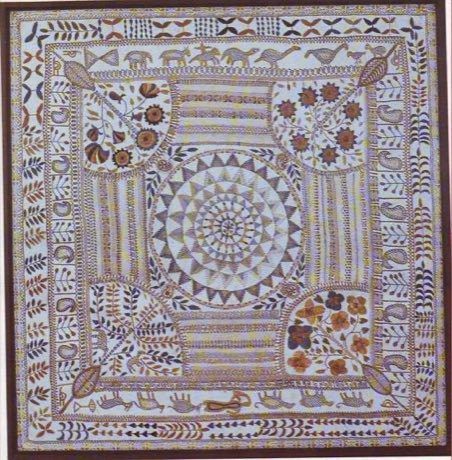

# Nakshi Kantha embroidery

*Also known as: নকশি কাঁথা*

**Encyclopedia ID 294** (permanent) · https://bpupadhyaya.github.io/world-heritage-games-site/games/294-nakshi-kantha-embroidery/

*Photo: A junaid alam khan (talk), [Public domain](https://creativecommons.org/publicdomain/mark/1.0/), [source on Wikimedia Commons](https://commons.wikimedia.org/wiki/File:Nakshi_kantha1.JPG)*

Fill a quilt with running-stitch motifs (birds, fish, flowers, circles) in coloured thread to match and extend a pattern.

## Heritage note

Part of the living heritage of Bangladesh.

## Origins

A living tradition passed from person to person; it is not tied to a single dated origin. It belongs to the cultural world of South Asia.

## Facts

- **Where:** Bangladesh
- **Type:** Crafts and making
- **Family:** Textile and weaving crafts
- **Era:** [Living Traditions](../../eras/living/index.md)
- **Cradle:** [South Asia](../../cradles/south-asia/index.md)
- **Region:** South and Central Asia

## Related entries

- [Kantha running-stitch quilt](../../games/284-kantha-running-stitch-quilt/index.md)
- [Jamdani muslin weaving](../../games/1305-jamdani-muslin-weaving/index.md)
- [Shital pati cool mat weaving](../../games/1371-shital-pati-cool-mat-weaving/index.md)
- [Dhaka weave pattern loom](../../games/115-dhaka-weave-pattern-loom/index.md)
- [Phulkari darn-stitch embroidery](../../games/257-phulkari-darn-stitch-embroidery/index.md)
- [Bandhani tie-dye](../../games/258-bandhani-tie-dye/index.md)

## Sources

- <https://commons.wikimedia.org/wiki/File:Nakshi_kantha1.JPG>
