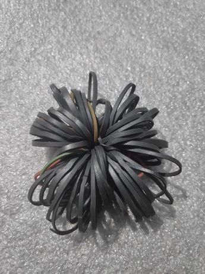

# Chungi

*चुङ्गी · rubber-band footbag*

**Encyclopedia ID 297** (permanent) · https://equalinformation.com/world-heritage-games-site/games/297-chungi/

*Photo: Gaurav Dhwaj Khadka, [CC BY-SA 4.0](https://creativecommons.org/licenses/by-sa/4.0/), [source on Wikimedia Commons](https://commons.wikimedia.org/wiki/File:Chungi.jpg)*

Keep a ball made of tied rubber bands in the air with the feet, counting kicks and tricks without dropping it.

## Heritage note

Part of the living heritage of Nepal, India.

## Origins

Usually placed in the era of Modern Heritage (1800 to today), although its exact origins are uncertain, within the cultural world of South Asia.

## Facts

- **Where:** Nepal, India
- **Type:** Dexterity and skill games
- **Family:** Puzzle and dexterity toys
- **Era:** [Modern Heritage](../../eras/modern/index.md) (uncertain)
- **Cradle:** [South Asia](../../cradles/south-asia/index.md)
- **Region:** South and Central Asia

## Related entries

- [Thanjavur dancing doll](../../games/275-thanjavur-dancing-doll/index.md)
- [Dandi Biyo](../../games/968-dandi-biyo/index.md)
- [Hill-country tea plucking](../../games/1297-hill-country-tea-plucking/index.md)
- [Stone put](../../games/589-stone-put/index.md)
- [Dego](../../games/590-dego/index.md)
- [Gulli Danda](../../games/1003-gulli-danda/index.md)

## Sources

- <https://commons.wikimedia.org/wiki/File:Chungi.jpg>
