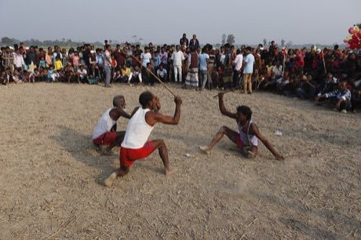

# Lathi Khela

*Also known as: লাঠি খেলা · stick duel*

**Encyclopedia ID 298** (permanent) · https://bpupadhyaya.github.io/world-heritage-games-site/games/298-lathi-khela/

*Photo: Frameofashik, [CC BY-SA 4.0](https://creativecommons.org/licenses/by-sa/4.0/), [source on Wikimedia Commons](https://commons.wikimedia.org/wiki/File:Traditional_Lathi_Khela_of_Rural_Bangladesh_334.jpg)*

Two fighters with long bamboo staffs trade guarded strikes in a ring until one scores three touches.

## Heritage note

Part of the living heritage of Bangladesh. It is presented as sport and skill, never as real fighting.

## Origins

Usually placed in the era of Classical Worlds (about 1000 BCE to 500 CE), although its exact origins are uncertain, within the cultural world of South Asia.

## Facts

- **Where:** Bangladesh
- **Type:** Wrestling and martial sports
- **Era:** [Classical Worlds](../../eras/classical/index.md) (uncertain)
- **Cradle:** [South Asia](../../cradles/south-asia/index.md)
- **Region:** South and Central Asia

## Related entries

- [Kotta Pora](../../games/18-kotta-pora/index.md)
- [Kathputli string puppets](../../games/79-kathputli-string-puppets/index.md)
- [Bansuri bamboo flute](../../games/149-bansuri-bamboo-flute/index.md)
- [Silambam](../../games/271-silambam/index.md)
- [Stilt fishing](../../games/288-stilt-fishing/index.md)
- [Murchunga](../../games/290-murchunga/index.md)

## Sources

- <https://commons.wikimedia.org/wiki/File:Traditional_Lathi_Khela_of_Rural_Bangladesh_334.jpg>
