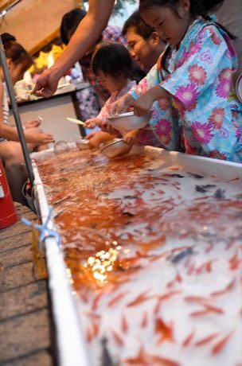

# Kingyo-sukui

*Also known as: 金魚すくい · goldfish scooping*

**Encyclopedia ID 3** (permanent) · https://bpupadhyaya.github.io/world-heritage-games-site/games/3-kingyo-sukui/

*Photo: Takuya Matsuyama, [CC BY 3.0](https://creativecommons.org/licenses/by/3.0/), [source on Wikimedia Commons](https://commons.wikimedia.org/wiki/File:Goldfish_Scooping_%E9%87%91%E9%AD%9A%E3%81%99%E3%81%8F%E3%81%84_(169719613).jpeg)*

Scoop goldfish from a tank with a thin paper-framed scoop (poi) before it tears, using gentle angles and quick tilts to catch the most fish.

## Heritage note

Part of the living heritage of Japan. Animals are partners in this tradition; good care and local rules always come first.

## Origins

Usually placed in the era of Modern Heritage (1800 to today), although its exact origins are uncertain, within the cultural world of Japan and Korea.

## Facts

- **Where:** Japan
- **Type:** Dexterity and skill games
- **Family:** Puzzle and dexterity toys
- **Era:** [Modern Heritage](../../eras/modern/index.md) (uncertain)
- **Cradle:** [Japan and Korea](../../cradles/japan-korea/index.md)
- **Region:** East and Southeast Asia

## Play it

[Try a 90-second preview in your browser](https://bpupadhyaya.github.io/games-site/games/kingyo-sukui/play/) · [Google Play](https://play.google.com/store/apps/details?id=com.equalinformation.arcforge.shell) · [App Store](https://apps.apple.com/us/app/arcforge-world-heritage-games/id6813746442)

## Related entries

- [Secret Puzzle Box](../../games/29-secret-puzzle-box/index.md)
- [Daruma Otoshi](../../games/63-daruma-otoshi/index.md)
- [Menko](../../games/346-menko/index.md)
- [Kamishibai](../../games/353-kamishibai/index.md)
- [Tatami room tiling puzzle](../../games/356-tatami-room-tiling-puzzle/index.md)
- [Hashi](../../games/360-hashi/index.md)

## Sources

- <https://commons.wikimedia.org/wiki/File:Goldfish_Scooping_%E9%87%91%E9%AD%9A%E3%81%99%E3%81%8F%E3%81%84_(169719613).jpeg>
