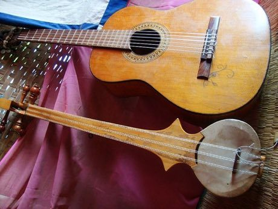

# Dranyen

*Also known as: སྒྲ་སྙན · Tibetan long-neck lute*

**Encyclopedia ID 300** (permanent) · https://bpupadhyaya.github.io/world-heritage-games-site/games/300-dranyen/

*Photo: ~maja*majika~, [CC BY 2.0](https://creativecommons.org/licenses/by/2.0/), [source on Wikimedia Commons](https://commons.wikimedia.org/wiki/File:Dramyin_(Tibetan_lute)_and_my_uncles_guitar.jpg)*

Pluck the six-string long-neck lute (dramyin) along a folk-song melody on a fretless neck.

## Heritage note

Part of the living heritage of China.

## Origins

Usually placed in the era of Crossroads and Golden Ages (about 500 to 1500), although its exact origins are uncertain, within the cultural world of China.

## Facts

- **Where:** China
- **Type:** Musical instruments
- **Family:** String instruments
- **Era:** [Crossroads and Golden Ages](../../eras/crossroads/index.md) (uncertain)
- **Cradle:** [China](../../cradles/china/index.md)
- **Region:** East and Southeast Asia

## Related entries

- [Erhu Two-String Fiddle](../../games/139-erhu-two-string-fiddle/index.md)
- [Dombra](../../games/48-dombra/index.md)
- [Charango](../../games/55-charango/index.md)
- [Buzuq Long-Neck Lute](../../games/218-buzuq-long-neck-lute/index.md)
- [Komuz](../../games/242-komuz/index.md)
- [Saz / Bağlama](../../games/243-saz-baglama/index.md)

## Sources

- <https://commons.wikimedia.org/wiki/File:Dramyin_(Tibetan_lute)_and_my_uncles_guitar.jpg>
