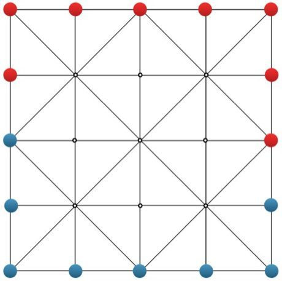

# Co Ganh

*Also known as: Vietnamese flanking game*

**Encyclopedia ID 301** (permanent) · https://bpupadhyaya.github.io/world-heritage-games-site/games/301-co-ganh/

*Photo: Tttrung, [CC BY-SA 4.0](https://creativecommons.org/licenses/by-sa/4.0/), [source on Wikimedia Commons](https://commons.wikimedia.org/wiki/File:Ganh_Chess.png)*

Two players with 8 pieces each on a 5x5 diagonal-lined board move one step at a time; sandwiching an enemy piece (or two) between your pieces flips them to your colour, and trapped groups can be captured en bloc.

## Heritage note

Part of the living heritage of Vietnam.

## Origins

Usually placed in the era of Crossroads and Golden Ages (about 500 to 1500), although its exact origins are uncertain, within the cultural world of Southeast Asia and the Islands.

## Facts

- **Where:** Vietnam
- **Type:** Board and table games
- **Era:** [Crossroads and Golden Ages](../../eras/crossroads/index.md) (uncertain)
- **Cradle:** [Southeast Asia and the Islands](../../cradles/southeast-asia/index.md)
- **Region:** East and Southeast Asia

## Related entries

- [Vietnamese xiangqi](../../games/1215-vietnamese-xiangqi/index.md)
- [Sittuyin](../../games/302-sittuyin/index.md)
- [Floating market trader](../../games/315-floating-market-trader/index.md)
- [Pinisi](../../games/327-pinisi/index.md)
- [Khmer chess](../../games/616-khmer-chess/index.md)
- [Gaple dominoes](../../games/804-gaple-dominoes/index.md)

## Sources

- <https://commons.wikimedia.org/wiki/File:Ganh_Chess.png>
