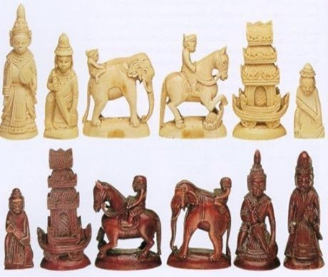

# Sittuyin

*စစ်တုရင် · Burmese chess*

**Encyclopedia ID 302** (permanent) · https://bpupadhyaya.github.io/world-heritage-games-site/games/302-sittuyin/

*Photo: Wikimerge, [CC BY-SA 4.0](https://creativecommons.org/licenses/by-sa/4.0/), [source on Wikimedia Commons](https://commons.wikimedia.org/wiki/File:Sittuyin-pieces.jpg)*

Players secretly place their pieces on their half of an 8x8 board behind a curtain, then play a chess-family game where pawns promote on marked diagonals.

## Heritage note

Part of the living heritage of Myanmar.

## Origins

Usually placed in the era of Crossroads and Golden Ages (about 500 to 1500), although its exact origins are uncertain, within the cultural world of Southeast Asia and the Islands.

## Facts

- **Where:** Myanmar
- **Type:** Board and table games
- **Family:** Chess family
- **Era:** [Crossroads and Golden Ages](../../eras/crossroads/index.md) (uncertain)
- **Cradle:** [Southeast Asia and the Islands](../../cradles/southeast-asia/index.md)
- **Region:** East and Southeast Asia
- **Players:** 2

## Related entries

- [Khmer chess](../../games/616-khmer-chess/index.md)
- [Lao chess](../../games/875-lao-chess/index.md)
- [Thai chess](../../games/1141-thai-chess/index.md)
- [Vietnamese xiangqi](../../games/1215-vietnamese-xiangqi/index.md)
- [Chaturanga](../../games/45-chaturanga/index.md)
- [Mongolian chess](../../games/943-mongolian-chess/index.md)

## Sources

- <https://commons.wikimedia.org/wiki/File:Sittuyin-pieces.jpg>
- <https://en.wikipedia.org/wiki/Sittuyin>
- <https://en.wikipedia.org/wiki/Traditional_games_of_Myanmar>
