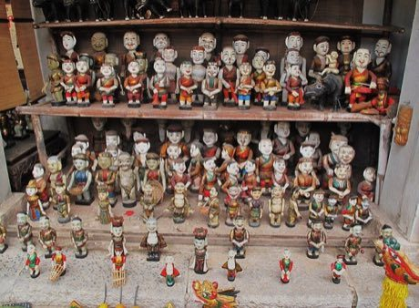

# Water puppet pond theatre

*Múa rối nước*

**Encyclopedia ID 303** (permanent) · https://bpupadhyaya.github.io/world-heritage-games-site/games/303-water-puppet-pond-theatre/

*Photo: Francisco Anzola, [CC BY 2.0](https://creativecommons.org/licenses/by/2.0/), [source on Wikimedia Commons](https://commons.wikimedia.org/wiki/File:Vietnamese_water_puppets_(7175324339).jpg)*

Direct lacquered wooden puppets with hidden poles and strings across a pond stage, timing moves to folk music and acting out village life scenes such as rice planting and fishing.

## Heritage note

Part of the living heritage of Vietnam. Some forms of this practice carry deep meaning for the communities who keep it; here we describe the play and the craft only, with respect for its roots.

## Origins

Usually placed in the era of Classical Worlds (about 1000 BCE to 500 CE), although its exact origins are uncertain, within the cultural world of Southeast Asia and the Islands.

## Facts

- **Where:** Vietnam
- **Type:** Performance and storytelling
- **Family:** Puppetry and shadow play
- **Era:** [Classical Worlds](../../eras/classical/index.md) (uncertain)
- **Cradle:** [Southeast Asia and the Islands](../../cradles/southeast-asia/index.md)
- **Region:** East and Southeast Asia

## Related entries

- [Yoke thé](../../games/314-yoke-the/index.md)
- [Aragoz Hand-Puppet Booth](../../games/222-aragoz-hand-puppet-booth/index.md)
- [Sicilian Puppet Knights](../../games/514-sicilian-puppet-knights/index.md)
- [Egrang](../../games/17-egrang/index.md)
- [Saung gauk](../../games/306-saung-gauk/index.md)
- [Sasando](../../games/317-sasando/index.md)

## Sources

- <https://commons.wikimedia.org/wiki/File:Vietnamese_water_puppets_(7175324339).jpg>
