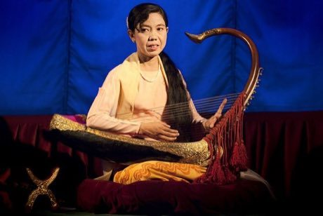

# Saung gauk

*စောင်းကောက် · Burmese arched harp*

**Encyclopedia ID 306** (permanent) · https://equalinformation.com/world-heritage-games-site/games/306-saung-gauk/

*Photo: Philip Nalangan, [CC BY-SA 4.0](https://creativecommons.org/licenses/by-sa/4.0/), [source on Wikimedia Commons](https://commons.wikimedia.org/wiki/File:Saung_Gauk_Harp_Mandalay.jpg)*

Pluck 13 silk strings of a boat-bodied arched harp to follow falling-note songs or improvise melodies.

## Heritage note

Part of the living heritage of Myanmar.

## Origins

Usually placed in the era of Classical Worlds (about 1000 BCE to 500 CE), although its exact origins are uncertain, within the cultural world of Southeast Asia and the Islands.

## Facts

- **Where:** Myanmar
- **Type:** Musical instruments
- **Family:** String instruments
- **Era:** [Classical Worlds](../../eras/classical/index.md) (uncertain)
- **Cradle:** [Southeast Asia and the Islands](../../cradles/southeast-asia/index.md)
- **Region:** East and Southeast Asia

## Related entries

- [Sasando](../../games/317-sasando/index.md)
- [Morin khuur](../../games/34-morin-khuur/index.md)
- [Kathputli string puppets](../../games/79-kathputli-string-puppets/index.md)
- [Valiha tube zither](../../games/124-valiha-tube-zither/index.md)
- [Krar lyre](../../games/126-krar-lyre/index.md)
- [Joropo llanero band](../../games/130-joropo-llanero-band/index.md)

## Sources

- <https://commons.wikimedia.org/wiki/File:Saung_Gauk_Harp_Mandalay.jpg>
