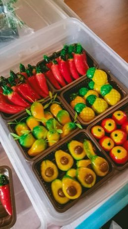

# Luk chup

*ลูกชุบ · painted mung-bean fruits*

**Encyclopedia ID 307** (permanent) · https://equalinformation.com/world-heritage-games-site/games/307-luk-chup/

*Photo: Aqilla Rahmi, [CC BY 4.0](https://creativecommons.org/licenses/by/4.0/), [source on Wikimedia Commons](https://commons.wikimedia.org/wiki/File:Luk_Chup_Thailand.jpg)*

Mould sweet mung-bean paste into tiny fruits, paint with edible colours, then dip in glossy agar jelly to finish matching tiny orders.

## Heritage note

Part of the living heritage of Thailand.

## Origins

A living tradition passed from person to person; it is not tied to a single dated origin. It belongs to the cultural world of Southeast Asia and the Islands.

## Facts

- **Where:** Thailand
- **Type:** Crafts and making
- **Family:** Paper, ink and painting crafts
- **Era:** [Living Traditions](../../eras/living/index.md)
- **Cradle:** [Southeast Asia and the Islands](../../cradles/southeast-asia/index.md)
- **Region:** East and Southeast Asia

## Related entries

- [Bo Sang umbrella painting](../../games/1243-bo-sang-umbrella-painting/index.md)
- [Jeepney painting](../../games/1306-jeepney-painting/index.md)
- [Ebru paper marbling](../../games/20-ebru-paper-marbling/index.md)
- [Ndebele geometric wall painting](../../games/23-ndebele-geometric-wall-painting/index.md)
- [Chinese knotting](../../games/26-chinese-knotting/index.md)
- [Matryoshka](../../games/28-matryoshka/index.md)

## Sources

- <https://commons.wikimedia.org/wiki/File:Luk_Chup_Thailand.jpg>
