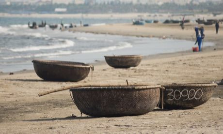

# Thung chai basket-boat spinning

*thúng chai*

**Encyclopedia ID 308** (permanent) · https://bpupadhyaya.github.io/world-heritage-games-site/games/308-thung-chai-basket-boat-spinning/

*Photo: CEphoto, Uwe Aranas, [CC BY-SA 3.0](https://creativecommons.org/licenses/by-sa/3.0/), [source on Wikimedia Commons](https://commons.wikimedia.org/wiki/File:Da-Nang_Vietnam_Coracles-01.jpg)*

Row a round woven basket boat by twisting the oar so it spins and steers through waves to gather nets and catch fish without capsizing.

## Heritage note

Part of the living heritage of Vietnam.

## Origins

Usually placed in the era of Age of Contact and Craft (about 1500 to 1800), although its exact origins are uncertain, within the cultural world of Southeast Asia and the Islands.

## Facts

- **Where:** Vietnam
- **Type:** Racing
- **Family:** Puzzle and dexterity toys
- **Era:** [Age of Contact and Craft](../../eras/contact/index.md) (uncertain)
- **Cradle:** [Southeast Asia and the Islands](../../cradles/southeast-asia/index.md)
- **Region:** East and Southeast Asia

## Related entries

- [Intha leg rowing on the lake](../../games/304-intha-leg-rowing-on-the-lake/index.md)
- [Charro lasso roping](../../games/60-charro-lasso-roping/index.md)
- [Fukuwarai](../../games/94-fukuwarai/index.md)
- [Sangaku Geometry Puzzles](../../games/109-sangaku-geometry-puzzles/index.md)
- [Lo Shu Magic Square](../../games/111-lo-shu-magic-square/index.md)
- [Stone Arch Bridge Builder](../../games/495-stone-arch-bridge-builder/index.md)

## Sources

- <https://commons.wikimedia.org/wiki/File:Da-Nang_Vietnam_Coracles-01.jpg>
