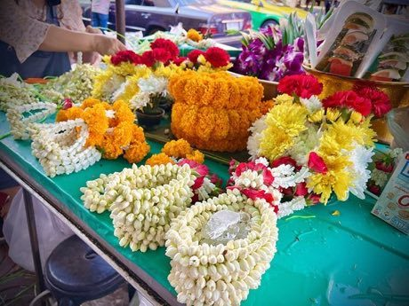

# Phuang malai flower garland threading

*Also known as: พวงมาลัย*

**Encyclopedia ID 309** (permanent) · https://bpupadhyaya.github.io/world-heritage-games-site/games/309-phuang-malai-flower-garland-threading/

*Photo: Sharon Hahn Darlin, [CC BY 2.0](https://creativecommons.org/licenses/by/2.0/), [source on Wikimedia Commons](https://commons.wikimedia.org/wiki/File:Bangkok,_Thailand,_March_2023_-_Jasmine_phuang_malai_(flower_garland).jpg)*

Thread jasmine buds, marigold petals and folded petals onto a string in the right order to match garland patterns within a time limit.

## Heritage note

Part of the living heritage of Thailand. Some forms of this practice carry deep meaning for the communities who keep it; here we describe the play and the craft only, with respect for its roots.

## Origins

A living tradition passed from person to person; it is not tied to a single dated origin. It belongs to the cultural world of Southeast Asia and the Islands.

## Facts

- **Where:** Thailand
- **Type:** Crafts and making
- **Family:** String instruments
- **Era:** [Living Traditions](../../eras/living/index.md)
- **Cradle:** [Southeast Asia and the Islands](../../cradles/southeast-asia/index.md)
- **Region:** East and Southeast Asia

## Related entries

- [Dan bau](../../games/143-dan-bau/index.md)
- [Santur Hammer Strings](../../games/138-santur-hammer-strings/index.md)
- [Santoor](../../games/151-santoor/index.md)
- [Goje One-String Fiddle](../../games/176-goje-one-string-fiddle/index.md)
- [Masenqo and the azmari](../../games/187-masenqo-and-the-azmari/index.md)
- [Hira gasy village troupe contest](../../games/205-hira-gasy-village-troupe-contest/index.md)

## Sources

- <https://commons.wikimedia.org/wiki/File:Bangkok,_Thailand,_March_2023_-_Jasmine_phuang_malai_(flower_garland).jpg>
