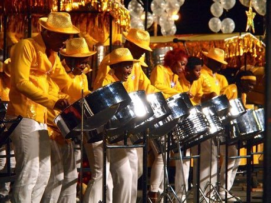

# Steelpan

*Steelpan / steel drum*

**Encyclopedia ID 31** (permanent) · https://bpupadhyaya.github.io/world-heritage-games-site/games/31-steelpan/

*Photo: Kip1234, [CC BY-SA 4.0](https://creativecommons.org/licenses/by-sa/4.0/), [source on Wikimedia Commons](https://commons.wikimedia.org/wiki/File:Steelpan_Instruments_at_Trinidad_and_Tobago_Carnival.jpg)*

Strike tuned notes on a hammered pan following scrolling melodies, building band parts for calypso tunes.

## Heritage note

Part of the living heritage of Trinidad and Tobago.

## Origins

Usually placed in the era of Age of Contact and Craft (about 1500 to 1800), although its exact origins are uncertain, within the cultural world of The Americas: Caribbean.

## Facts

- **Where:** Trinidad and Tobago
- **Type:** Musical instruments
- **Family:** Drums and percussion
- **Era:** [Age of Contact and Craft](../../eras/contact/index.md) (uncertain)
- **Cradle:** [The Americas: Caribbean](../../cradles/caribbean/index.md)
- **Region:** Americas

## Related entries

- [Bandoneon and tango rhythm](../../games/426-bandoneon-and-tango-rhythm/index.md)
- [Bodhran Frame Drum](../../games/521-bodhran-frame-drum/index.md)
- [Haitian Oil-Drum Metal Cut-Out Art](../../games/1460-haitian-oil-drum-metal-cut-out-art/index.md)
- [Yard cricket](../../games/1151-yard-cricket/index.md)
- [Mbira](../../games/32-mbira/index.md)
- [Talking drum](../../games/33-talking-drum/index.md)

## Sources

- <https://commons.wikimedia.org/wiki/File:Steelpan_Instruments_at_Trinidad_and_Tobago_Carnival.jpg>
