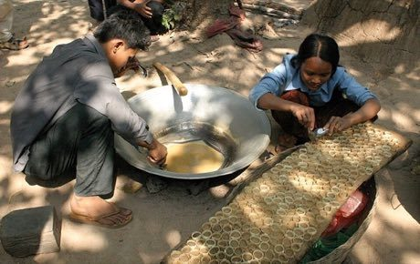

# Palm sugar boiling and mould-filling

*Also known as: ស្ករត្នោត*

**Encyclopedia ID 313** (permanent) · https://bpupadhyaya.github.io/world-heritage-games-site/games/313-palm-sugar-boiling-and-mould-filling/

*Photo: Gerd Eichmann, [CC BY-SA 4.0](https://creativecommons.org/licenses/by-sa/4.0/), [source on Wikimedia Commons](https://commons.wikimedia.org/wiki/File:Cambodia-Palm_sugar-14-2007-gje.jpg)*

Climb the sugar palm, collect sap, boil to caramel, pour into moulds and sell batches in a rural market.

## Heritage note

Part of the living heritage of Cambodia.

## Origins

A living tradition passed from person to person; it is not tied to a single dated origin. It belongs to the cultural world of Southeast Asia and the Islands.

## Facts

- **Where:** Cambodia
- **Type:** Crafts and making
- **Era:** [Living Traditions](../../eras/living/index.md)
- **Cradle:** [Southeast Asia and the Islands](../../cradles/southeast-asia/index.md)
- **Region:** East and Southeast Asia

## Related entries

- [Greasy pole climb](../../games/77-greasy-pole-climb/index.md)
- [Batik wax-resist pattern studio](../../games/105-batik-wax-resist-pattern-studio/index.md)
- [Thai fruit and vegetable carving](../../games/114-thai-fruit-and-vegetable-carving/index.md)
- [Angklung bamboo chime ensemble](../../games/142-angklung-bamboo-chime-ensemble/index.md)
- [Dan bau](../../games/143-dan-bau/index.md)
- [Khene](../../games/145-khene/index.md)

## Sources

- <https://commons.wikimedia.org/wiki/File:Cambodia-Palm_sugar-14-2007-gje.jpg>
