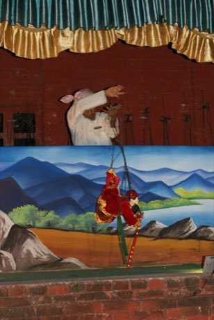

# Yoke thé

*ရုပ်သေးရုံ · Burmese marionette theatre*

**Encyclopedia ID 314** (permanent) · https://equalinformation.com/world-heritage-games-site/games/314-yoke-the/

*Photo: Jacklee, [CC BY-SA 4.0](https://creativecommons.org/licenses/by-sa/4.0/), [source on Wikimedia Commons](https://commons.wikimedia.org/wiki/File:Traditional_puppet_show,_Bagan,_Myanmar_-_20141209-05.JPG)*

Control strings of a jointed puppet to dance, bow and fight in timed gestures against a painted backdrop with music.

## Heritage note

Part of the living heritage of Myanmar.

## Origins

Usually placed in the era of Classical Worlds (about 1000 BCE to 500 CE), although its exact origins are uncertain, within the cultural world of Southeast Asia and the Islands.

## Facts

- **Where:** Myanmar
- **Type:** Performance and storytelling
- **Family:** Puppetry and shadow play
- **Era:** [Classical Worlds](../../eras/classical/index.md) (uncertain)
- **Cradle:** [Southeast Asia and the Islands](../../cradles/southeast-asia/index.md)
- **Region:** East and Southeast Asia

## Related entries

- [Water puppet pond theatre](../../games/303-water-puppet-pond-theatre/index.md)
- [Aragoz Hand-Puppet Booth](../../games/222-aragoz-hand-puppet-booth/index.md)
- [Sicilian Puppet Knights](../../games/514-sicilian-puppet-knights/index.md)
- [Saung gauk](../../games/306-saung-gauk/index.md)
- [Egrang](../../games/17-egrang/index.md)
- [Sasando](../../games/317-sasando/index.md)

## Sources

- <https://commons.wikimedia.org/wiki/File:Traditional_puppet_show,_Bagan,_Myanmar_-_20141209-05.JPG>
