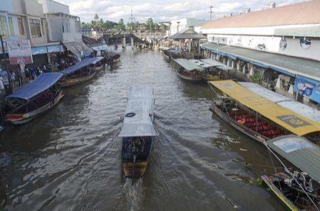

# Floating market trader

*Also known as: ตลาดน้ำ*

**Encyclopedia ID 315** (permanent) · https://bpupadhyaya.github.io/world-heritage-games-site/games/315-floating-market-trader/

*Photo: Rangan Datta Wiki, [CC BY-SA 4.0](https://creativecommons.org/licenses/by-sa/4.0/), [source on Wikimedia Commons](https://commons.wikimedia.org/wiki/File:Amphawa_Floating_Market_3.jpg)*

Paddle a boat along a canal, select the right fruit, noodles or sweets for each customer boat and keep the cargo balanced.

## Heritage note

Part of the living heritage of Thailand.

## Origins

Usually placed in the era of Crossroads and Golden Ages (about 500 to 1500), although its exact origins are uncertain, within the cultural world of Southeast Asia and the Islands.

## Facts

- **Where:** Thailand
- **Type:** Board and table games
- **Era:** [Crossroads and Golden Ages](../../eras/crossroads/index.md) (uncertain)
- **Cradle:** [Southeast Asia and the Islands](../../cradles/southeast-asia/index.md)
- **Region:** East and Southeast Asia

## Related entries

- [Thai chess](../../games/1141-thai-chess/index.md)
- [Thai checkers](../../games/1142-thai-checkers/index.md)
- [Makyek](../../games/1143-makyek/index.md)
- [Co Ganh](../../games/301-co-ganh/index.md)
- [Sittuyin](../../games/302-sittuyin/index.md)
- [Pinisi](../../games/327-pinisi/index.md)

## Sources

- <https://commons.wikimedia.org/wiki/File:Amphawa_Floating_Market_3.jpg>
