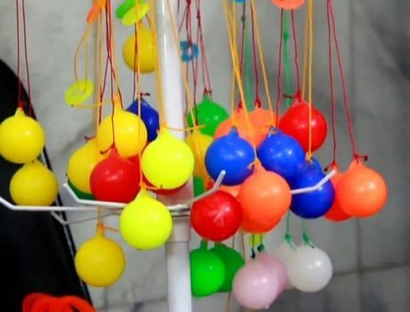

# Lato-lato

*Lato-lato · clackers*

**Encyclopedia ID 316** (permanent) · https://bpupadhyaya.github.io/world-heritage-games-site/games/316-lato-lato/

*Photo: AntaraTV, [CC BY 3.0](https://creativecommons.org/licenses/by/3.0/), [source on Wikimedia Commons](https://commons.wikimedia.org/wiki/File:Lato-lato.jpg)*

Swing two hard balls on a cord so they click against each other, keeping the rhythm going as long as possible.

## Heritage note

Part of the living heritage of Indonesia, Malaysia.

## Origins

Usually placed in the era of Modern Heritage (1800 to today), although its exact origins are uncertain, within the cultural world of Southeast Asia and the Islands.

## Facts

- **Where:** Indonesia, Malaysia
- **Type:** Toys
- **Family:** Puzzle and dexterity toys
- **Era:** [Modern Heritage](../../eras/modern/index.md) (uncertain)
- **Cradle:** [Southeast Asia and the Islands](../../cradles/southeast-asia/index.md)
- **Region:** East and Southeast Asia

## Related entries

- [Tinikling](../../games/141-tinikling/index.md)
- [Kingyo-sukui](../../games/3-kingyo-sukui/index.md)
- [Stone Skipping](../../games/5-stone-skipping/index.md)
- [Disc-flip](../../games/8-disc-flip/index.md)
- [Sjoelen](../../games/9-sjoelen/index.md)
- [Egrang](../../games/17-egrang/index.md)

## Sources

- <https://commons.wikimedia.org/wiki/File:Lato-lato.jpg>
