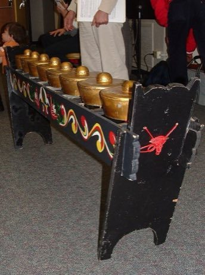

# Kulintang

*Also known as: gong-chime row*

**Encyclopedia ID 318** (permanent) · https://bpupadhyaya.github.io/world-heritage-games-site/games/318-kulintang/

*Photo: Philip Dominguez Mercurio, [CC BY-SA 2.5](https://creativecommons.org/licenses/by-sa/2.5/), [source on Wikimedia Commons](https://commons.wikimedia.org/wiki/File:Kulintang_08.jpg)*

Strike a row of eight small horizontal gongs with two beaters, following the melodic patterns over drone gongs.

## Heritage note

Part of the living heritage of Philippines, Malaysia, Brunei. Some forms of this practice carry deep meaning for the communities who keep it; here we describe the play and the craft only, with respect for its roots.

## Origins

Usually placed in the era of Classical Worlds (about 1000 BCE to 500 CE), although its exact origins are uncertain, within the cultural world of Southeast Asia and the Islands.

## Facts

- **Where:** Philippines, Malaysia, Brunei, Timor-Leste
- **Type:** Musical instruments
- **Family:** Drums and percussion
- **Era:** [Classical Worlds](../../eras/classical/index.md) (uncertain)
- **Cradle:** [Southeast Asia and the Islands](../../cradles/southeast-asia/index.md)
- **Region:** East and Southeast Asia

## Related entries

- [Egrang](../../games/17-egrang/index.md)
- [Ranat ek](../../games/305-ranat-ek/index.md)
- [Arnis / Eskrima](../../games/323-arnis-eskrima/index.md)
- [Pencak silat](../../games/329-pencak-silat/index.md)
- [Kampong Ayer water-taxi dash](../../games/1308-kampong-ayer-water-taxi-dash/index.md)
- [Wau bulan kite](../../games/911-wau-bulan-kite/index.md)

## Sources

- <https://commons.wikimedia.org/wiki/File:Kulintang_08.jpg>
