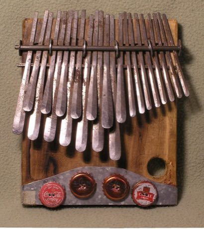

# Mbira

*Also known as: Kalimba · Sanza · Thumb Piano*

**Encyclopedia ID 32** (permanent) · https://bpupadhyaya.github.io/world-heritage-games-site/games/32-mbira/

*Photo: Alex Weeks, [CC BY-SA 3.0](https://creativecommons.org/licenses/by-sa/3.0/), [source on Wikimedia Commons](https://commons.wikimedia.org/wiki/File:Holding_an_mbira_dzavadzimu.jpg)*

follow falling notes in learn mode, or play freely and layer looping parts.

## Heritage note

Part of the living heritage of Zimbabwe. Some forms of this practice carry deep meaning for the communities who keep it; here we describe the play and the craft only, with respect for its roots.

## Origins

Usually placed in the era of Crossroads and Golden Ages (about 500 to 1500), although its exact origins are uncertain, within the cultural world of Africa: Southern Africa.

## Facts

- **Where:** Zimbabwe
- **Type:** Musical instruments
- **Family:** Drums and percussion
- **Era:** [Crossroads and Golden Ages](../../eras/crossroads/index.md) (uncertain)
- **Cradle:** [Africa: Southern Africa](../../cradles/africa-south/index.md)
- **Region:** Sub-Saharan Africa

## Related entries

- [Steelpan](../../games/31-steelpan/index.md)
- [Talking drum](../../games/33-talking-drum/index.md)
- [Marimba](../../games/52-marimba/index.md)
- [Calabash Water Drum](../../games/180-calabash-water-drum/index.md)
- [Amadinda and embaire](../../games/185-amadinda-and-embaire/index.md)
- [Tombak goblet drum rhythms](../../games/233-tombak-goblet-drum-rhythms/index.md)

## Sources

- <https://commons.wikimedia.org/wiki/File:Holding_an_mbira_dzavadzimu.jpg>
