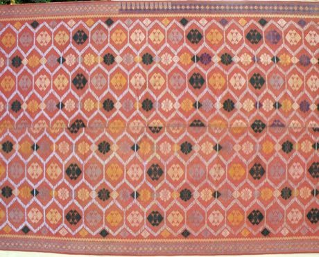

# Songket

*Also known as: supplementary-weft gold weaving*

**Encyclopedia ID 320** (permanent) · https://bpupadhyaya.github.io/world-heritage-games-site/games/320-songket/

*Photo: Chris Hazzard, [CC BY-SA 3.0](https://creativecommons.org/licenses/by-sa/3.0/), [source on Wikimedia Commons](https://commons.wikimedia.org/wiki/File:Songket,_Woven_on_backstrap_and_Joined_170_X_88cm_20121207_4.JPG)*

Lift selected warp threads and pass gold weft to build a motif row by row on a loom.

## Heritage note

Part of the living heritage of Malaysia, Brunei, Indonesia.

## Origins

A living tradition passed from person to person; it is not tied to a single dated origin. It belongs to the cultural world of Southeast Asia and the Islands.

## Facts

- **Where:** Malaysia, Brunei, Indonesia
- **Type:** Crafts and making
- **Family:** Textile and weaving crafts
- **Era:** [Living Traditions](../../eras/living/index.md)
- **Cradle:** [Southeast Asia and the Islands](../../cradles/southeast-asia/index.md)
- **Region:** East and Southeast Asia

## Related entries

- [Batik wax-resist pattern studio](../../games/105-batik-wax-resist-pattern-studio/index.md)
- [Ketupat](../../games/322-ketupat/index.md)
- [Lao silk brocade weaving](../../games/311-lao-silk-brocade-weaving/index.md)
- [Tais](../../games/321-tais/index.md)
- [Banig mat weaving](../../games/1236-banig-mat-weaving/index.md)
- [Kente strip weaving](../../games/22-kente-strip-weaving/index.md)

## Sources

- <https://commons.wikimedia.org/wiki/File:Songket,_Woven_on_backstrap_and_Joined_170_X_88cm_20121207_4.JPG>
