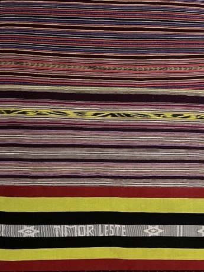

# Tais

*Also known as: Timorese backstrap weaving*

**Encyclopedia ID 321** (permanent) · https://bpupadhyaya.github.io/world-heritage-games-site/games/321-tais/

*Photo: Rahmaziz, [CC BY 4.0](https://creativecommons.org/licenses/by/4.0/), [source on Wikimedia Commons](https://commons.wikimedia.org/wiki/File:Tais_weaving_from_Timor_Leste.jpg)*

Build banded cloth with colour stripes and motif bands on a backstrap loom to match a pattern card.

## Heritage note

Part of the living heritage of Timor-Leste. Some forms of this practice carry deep meaning for the communities who keep it; here we describe the play and the craft only, with respect for its roots.

## Origins

A living tradition passed from person to person; it is not tied to a single dated origin. It belongs to the cultural world of Southeast Asia and the Islands.

## Facts

- **Where:** Timor-Leste
- **Type:** Crafts and making
- **Family:** Textile and weaving crafts
- **Era:** [Living Traditions](../../eras/living/index.md)
- **Cradle:** [Southeast Asia and the Islands](../../cradles/southeast-asia/index.md)
- **Region:** East and Southeast Asia

## Related entries

- [Batik wax-resist pattern studio](../../games/105-batik-wax-resist-pattern-studio/index.md)
- [Lao silk brocade weaving](../../games/311-lao-silk-brocade-weaving/index.md)
- [Songket](../../games/320-songket/index.md)
- [Ketupat](../../games/322-ketupat/index.md)
- [Banig mat weaving](../../games/1236-banig-mat-weaving/index.md)
- [Shan seed-treadle loom](../../games/18903-shan-seed-treadle-loom/index.md)

## Sources

- <https://commons.wikimedia.org/wiki/File:Tais_weaving_from_Timor_Leste.jpg>
