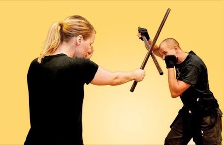

# Arnis / Eskrima

*Also known as: Arnis · Arnis stick fighting · stick sparring*

**Encyclopedia ID 323** (permanent) · https://bpupadhyaya.github.io/world-heritage-games-site/games/323-arnis-eskrima/

*Photo: Mr.Colling, [CC BY 3.0](https://creativecommons.org/licenses/by/3.0/), [source on Wikimedia Commons](https://commons.wikimedia.org/wiki/File:Eskrima.jpg)*

Strike and block with padded rattan sticks, scoring clean hits on armoured targets.

## Heritage note

Part of the living heritage of Philippines. It is presented as sport and skill, never as real fighting.

## Origins

Usually placed in the era of Classical Worlds (about 1000 BCE to 500 CE), although its exact origins are uncertain, within the cultural world of Southeast Asia and the Islands.

## Facts

- **Where:** Philippines, Timor-Leste
- **Type:** Wrestling and martial sports
- **Era:** [Classical Worlds](../../eras/classical/index.md) (uncertain)
- **Cradle:** [Southeast Asia and the Islands](../../cradles/southeast-asia/index.md)
- **Region:** East and Southeast Asia
- **Players:** 2

## Related entries

- [Kulintang](../../games/318-kulintang/index.md)
- [Egrang](../../games/17-egrang/index.md)
- [Water puppet pond theatre](../../games/303-water-puppet-pond-theatre/index.md)
- [Saung gauk](../../games/306-saung-gauk/index.md)
- [Yoke thé](../../games/314-yoke-the/index.md)
- [Sasando](../../games/317-sasando/index.md)

## Sources

- <https://commons.wikimedia.org/wiki/File:Eskrima.jpg>
- <https://en.wikipedia.org/wiki/Sport_in_East_Timor>
