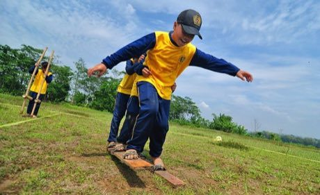

# Bakiak

*Bakiak / bakya · team clog race*

**Encyclopedia ID 324** (permanent) · https://equalinformation.com/world-heritage-games-site/games/324-bakiak/

*Photo: Faa.story, [CC BY-SA 4.0](https://creativecommons.org/licenses/by-sa/4.0/), [source on Wikimedia Commons](https://commons.wikimedia.org/wiki/File:Bakiak_(Teklek)_History_of_Java_Museum.jpg)*

Several players step in sync on one long wooden plank with footholds to race to the finish.

## Heritage note

Part of the living heritage of Indonesia, Malaysia, Philippines.

## Origins

Usually placed in the era of Age of Contact and Craft (about 1500 to 1800), although its exact origins are uncertain, within the cultural world of Southeast Asia and the Islands.

## Facts

- **Where:** Indonesia, Malaysia, Philippines
- **Type:** Racing
- **Era:** [Age of Contact and Craft](../../eras/contact/index.md) (uncertain)
- **Cradle:** [Southeast Asia and the Islands](../../cradles/southeast-asia/index.md)
- **Region:** East and Southeast Asia

## Related entries

- [Independence-day field games](../../games/330-independence-day-field-games/index.md)
- [Sack Race](../../games/476-sack-race/index.md)
- [Pacu jawi](../../games/1354-pacu-jawi/index.md)
- [Intha leg rowing on the lake](../../games/304-intha-leg-rowing-on-the-lake/index.md)
- [Thung chai basket-boat spinning](../../games/308-thung-chai-basket-boat-spinning/index.md)
- [Egrang](../../games/17-egrang/index.md)

## Sources

- <https://commons.wikimedia.org/wiki/File:Bakiak_(Teklek)_History_of_Java_Museum.jpg>
