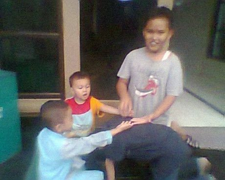

# Cublak-cublak suweng

*Cublak-cublak suweng · pass the hidden stone*

**Encyclopedia ID 325** (permanent) · https://equalinformation.com/world-heritage-games-site/games/325-cublak-cublak-suweng/

*Photo: SU03Ai, [CC BY-SA 3.0](https://creativecommons.org/licenses/by-sa/3.0/), [source on Wikimedia Commons](https://commons.wikimedia.org/wiki/File:Pacublak-cublak_uang.jpg)*

Players sit in a ring, one guesses who holds a hidden stone while it is passed behind hands to a traditional rhyme.

## Heritage note

Part of the living heritage of Indonesia.

## Origins

Usually placed in the era of Modern Heritage (1800 to today), although its exact origins are uncertain, within the cultural world of Southeast Asia and the Islands.

## Facts

- **Where:** Indonesia
- **Type:** Street and playground games
- **Family:** Rhyme and hand games
- **Era:** [Modern Heritage](../../eras/modern/index.md) (uncertain)
- **Cradle:** [Southeast Asia and the Islands](../../cradles/southeast-asia/index.md)
- **Region:** East and Southeast Asia

## Related entries

- [Dikir barat](../../games/1268-dikir-barat/index.md)
- [Double Dutch](../../games/53-double-dutch/index.md)
- [Woggabaliri](../../games/561-woggabaliri/index.md)
- [Finger pulling](../../games/563-finger-pulling/index.md)
- [Kriol traditional games](../../games/585-kriol-traditional-games/index.md)
- [Lato-lato](../../games/316-lato-lato/index.md)

## Sources

- <https://commons.wikimedia.org/wiki/File:Pacublak-cublak_uang.jpg>
