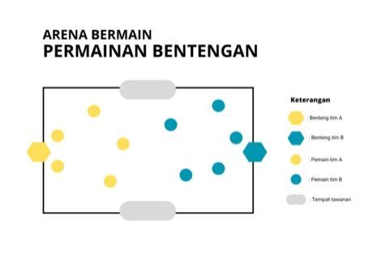

# Bentengan

*Also known as: fort-capture tag*

**Encyclopedia ID 326** (permanent) · https://bpupadhyaya.github.io/world-heritage-games-site/games/326-bentengan/

*Photo: Silvia Atriyanti Saputri, [CC BY-SA 4.0](https://creativecommons.org/licenses/by-sa/4.0/), [source on Wikimedia Commons](https://commons.wikimedia.org/wiki/File:ARENA_BERMAIN_PERMAINAN_BENTENGAN.png)*

Bentengan is a board and table game tradition from Indonesia.

## Heritage note

Part of the living heritage of Indonesia.

## Origins

Usually placed in the era of Deep Past and First Games (before about 3000 BCE), although its exact origins are uncertain, within the cultural world of Southeast Asia and the Islands.

## Facts

- **Where:** Indonesia
- **Type:** Board and table games
- **Era:** [Deep Past and First Games](../../eras/deep-past/index.md) (uncertain)
- **Cradle:** [Southeast Asia and the Islands](../../cradles/southeast-asia/index.md)
- **Region:** East and Southeast Asia

## Play it

[Try a 90-second preview in your browser](https://bpupadhyaya.github.io/games-site/games/bentengan/play/) · [Google Play](https://play.google.com/store/apps/details?id=com.equalinformation.arcforge.shell) · App Store (coming soon)

## Related entries

- [Gobak Sodor](../../games/46-gobak-sodor/index.md)
- [Congklak](../../games/803-congklak/index.md)
- [Pebbles](../../games/874-pebbles/index.md)
- [Galah panjang](../../games/909-galah-panjang/index.md)
- [Tag](../../games/959-tag/index.md)
- [Patintero](../../games/1021-patintero/index.md)

## Sources

- <https://commons.wikimedia.org/wiki/File:ARENA_BERMAIN_PERMAINAN_BENTENGAN.png>
