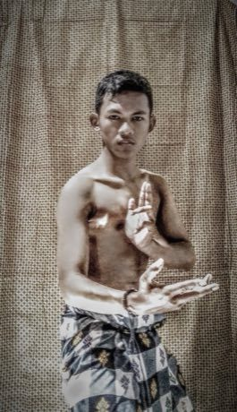

# Pencak silat

*Pencak silat · forms and sparring sport*

**Encyclopedia ID 329** (permanent) · https://equalinformation.com/world-heritage-games-site/games/329-pencak-silat/

*Photo: Sam Hidayat, [CC BY-SA 4.0](https://creativecommons.org/licenses/by-sa/4.0/), [source on Wikimedia Commons](https://commons.wikimedia.org/wiki/File:Indonesian_Pencak_Silat.jpg)*

Perform graceful forms and score sparring techniques, timing strikes, sweeps and blocks.

## Heritage note

Part of the living heritage of Indonesia, Malaysia, Brunei. Some forms of this practice carry deep meaning for the communities who keep it; here we describe the play and the craft only, with respect for its roots.

## Origins

Usually placed in the era of Classical Worlds (about 1000 BCE to 500 CE), although its exact origins are uncertain, within the cultural world of Southeast Asia and the Islands.

## Facts

- **Where:** Indonesia, Malaysia, Brunei, Singapore
- **Type:** Wrestling and martial sports
- **Era:** [Classical Worlds](../../eras/classical/index.md) (uncertain)
- **Cradle:** [Southeast Asia and the Islands](../../cradles/southeast-asia/index.md)
- **Region:** East and Southeast Asia

## Related entries

- [Egrang](../../games/17-egrang/index.md)
- [Sasando](../../games/317-sasando/index.md)
- [Kulintang](../../games/318-kulintang/index.md)
- [Kampong Ayer water-taxi dash](../../games/1308-kampong-ayer-water-taxi-dash/index.md)
- [Wau bulan kite](../../games/911-wau-bulan-kite/index.md)
- [Encang kuda](../../games/1067-encang-kuda/index.md)

## Sources

- <https://commons.wikimedia.org/wiki/File:Indonesian_Pencak_Silat.jpg>
