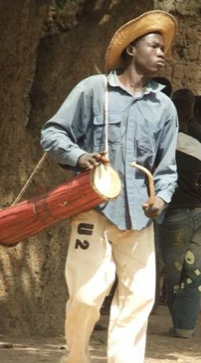

# Talking drum

*Also known as: Dùndún · Tama · Kalangu*

**Encyclopedia ID 33** (permanent) · https://bpupadhyaya.github.io/world-heritage-games-site/games/33-talking-drum/

*Photo: PGskot (User), [CC BY-SA 4.0](https://creativecommons.org/licenses/by-sa/4.0/), [source on Wikimedia Commons](https://commons.wikimedia.org/wiki/File:Talking_drum_(tama)player.jpg)*

Squeeze the hourglass drum cords with one hand and strike with a curved stick to bend pitch; mimic spoken tone phrases and rhythms as the game plays a call.

## Heritage note

Part of the living heritage of Nigeria. Some forms of this practice carry deep meaning for the communities who keep it; here we describe the play and the craft only, with respect for its roots.

## Origins

A living tradition passed from person to person; it is not tied to a single dated origin. It belongs to the cultural world of Africa: Sahel, West and Central.

## Facts

- **Where:** Nigeria
- **Type:** Musical instruments
- **Family:** Drums and percussion
- **Era:** [Living Traditions](../../eras/living/index.md)
- **Cradle:** [Africa: Sahel, West and Central](../../cradles/africa-west/index.md)
- **Region:** Sub-Saharan Africa

## Related entries

- [Calabash Water Drum](../../games/180-calabash-water-drum/index.md)
- [Ikoro](../../games/7189-ikoro/index.md)
- [Obrom slit drum](../../games/7192-obrom-slit-drum/index.md)
- [Cigogo iron bell](../../games/21362-cigogo-iron-bell/index.md)
- [Ogwumgwu board lamellophone](../../games/21365-ogwumgwu-board-lamellophone/index.md)
- [Ekpili seed-shell rattle](../../games/21377-ekpili-seed-shell-rattle/index.md)

## Sources

- <https://commons.wikimedia.org/wiki/File:Talking_drum_(tama)player.jpg>
