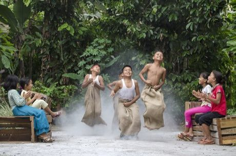

# Independence-day field games

*Lomba Agustusan · balap karung, sack race*

**Encyclopedia ID 330** (permanent) · https://bpupadhyaya.github.io/world-heritage-games-site/games/330-independence-day-field-games/

*Photo: Irsam Soetarto, [CC BY-SA 4.0](https://creativecommons.org/licenses/by-sa/4.0/), [source on Wikimedia Commons](https://commons.wikimedia.org/wiki/File:Balap_Karung.jpg)*

Hop in a sack, balance a marble spoon, or bite a hanging cracker without hands in a series of quick comic contests.

## Heritage note

Part of the living heritage of Indonesia. Some forms of this practice carry deep meaning for the communities who keep it; here we describe the play and the craft only, with respect for its roots.

## Origins

Usually placed in the era of Age of Contact and Craft (about 1500 to 1800), although its exact origins are uncertain, within the cultural world of Southeast Asia and the Islands.

## Facts

- **Where:** Indonesia
- **Type:** Racing
- **Era:** [Age of Contact and Craft](../../eras/contact/index.md) (uncertain)
- **Cradle:** [Southeast Asia and the Islands](../../cradles/southeast-asia/index.md)
- **Region:** East and Southeast Asia

## Related entries

- [Bakiak](../../games/324-bakiak/index.md)
- [Sack Race](../../games/476-sack-race/index.md)
- [Pacu jawi](../../games/1354-pacu-jawi/index.md)
- [Intha leg rowing on the lake](../../games/304-intha-leg-rowing-on-the-lake/index.md)
- [Thung chai basket-boat spinning](../../games/308-thung-chai-basket-boat-spinning/index.md)
- [Egrang](../../games/17-egrang/index.md)

## Sources

- <https://commons.wikimedia.org/wiki/File:Balap_Karung.jpg>
