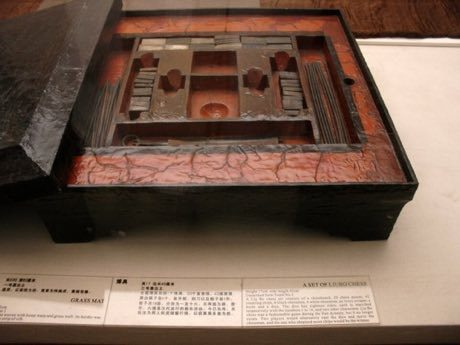

# Liubo

*六博 · Six Sticks*

**Encyclopedia ID 331** (permanent) · https://equalinformation.com/world-heritage-games-site/games/331-liubo/

*Photo: drs2biz on Flickr, [CC BY 2.0](https://creativecommons.org/licenses/by/2.0/), [source on Wikimedia Commons](https://commons.wikimedia.org/wiki/File:Lacquered_Liubo_Chess_Set.jpg)*

Two players each move six pieces around a cross-shaped lacquered board on twelve paths, rolling sticks or dice to advance and capture, aiming to bring pieces to the central 'pond' and score six points.

## Heritage note

Part of the living heritage of China.

## Origins

Usually placed in the era of River Valleys and First Cities (about 3000 to 1000 BCE), although its exact origins are uncertain, within the cultural world of China.

## Facts

- **Where:** China
- **Type:** Board and table games
- **Family:** Dice and knucklebone games
- **Era:** [River Valleys and First Cities](../../eras/river-valleys/index.md) (uncertain)
- **Cradle:** [China](../../cradles/china/index.md)
- **Region:** East and Southeast Asia

## Related entries

- [Sho](../../games/286-sho/index.md)
- [E-sugoroku](../../games/348-e-sugoroku/index.md)
- [Generala](../../games/422-generala/index.md)
- [Game of the Goose](../../games/450-game-of-the-goose/index.md)
- [Sáhkku](../../games/451-sahkku/index.md)
- [Parxís](../../games/542-parxis/index.md)

## Sources

- <https://commons.wikimedia.org/wiki/File:Lacquered_Liubo_Chess_Set.jpg>
