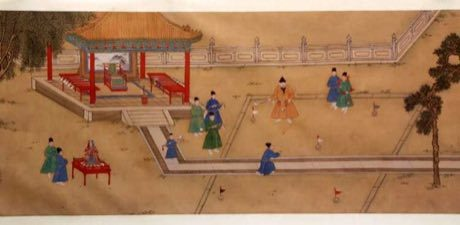

# Chuiwan

*捶丸 · ancient Chinese golf*

**Encyclopedia ID 332** (permanent) · https://equalinformation.com/world-heritage-games-site/games/332-chuiwan/

*Photo: unknown, [Public domain](https://creativecommons.org/publicdomain/mark/1.0/), [source on Wikimedia Commons](https://commons.wikimedia.org/wiki/File:Ming_Emperor_Xuande_playing_Golf.jpg)*

Players choose among a few club types (up to ten) to knock a ball across varied terrain into small holes marked by coloured flags, lowest strokes winning.

## Heritage note

Part of the living heritage of China.

## Origins

A living tradition passed from person to person; it is not tied to a single dated origin. It belongs to the cultural world of China.

## Facts

- **Where:** China
- **Type:** Other traditions
- **Era:** [Living Traditions](../../eras/living/index.md) (uncertain)
- **Cradle:** [China](../../cradles/china/index.md)
- **Region:** East and Southeast Asia

## Related entries

- [Chinese knotting](../../games/26-chinese-knotting/index.md)
- [Tanghua](../../games/64-tanghua/index.md)
- [Bianzhong](../../games/336-bianzhong/index.md)
- [Lamian](../../games/340-lamian/index.md)
- [Seal carving](../../games/341-seal-carving/index.md)
- [Cloisonne](../../games/343-cloisonne/index.md)

## Sources

- <https://commons.wikimedia.org/wiki/File:Ming_Emperor_Xuande_playing_Golf.jpg>
