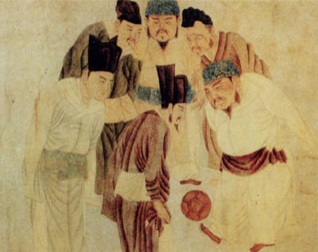

# Cuju

*蹴鞠 · ancient Chinese football*

**Encyclopedia ID 333** (permanent) · https://equalinformation.com/world-heritage-games-site/games/333-cuju/

*Photo: Qian Xuan, [Public domain](https://creativecommons.org/publicdomain/mark/1.0/), [source on Wikimedia Commons](https://commons.wikimedia.org/wiki/File:Emperor_Taizu_play_Cuju.jpg)*

Players kick and juggle a stuffed leather ball with feet and body, passing it among teammates or through a single goal in a net, scoring for style and accuracy.

## Heritage note

Part of the living heritage of China.

## Origins

Usually placed in the era of Classical Worlds (about 1000 BCE to 500 CE), although its exact origins are uncertain, within the cultural world of China.

## Facts

- **Where:** China
- **Type:** Dexterity and skill games
- **Family:** Kicking and football games
- **Era:** [Classical Worlds](../../eras/classical/index.md) (uncertain)
- **Cradle:** [China](../../cradles/china/index.md)
- **Region:** East and Southeast Asia

## Related entries

- [Tea Horse Road Caravan](../../games/39-tea-horse-road-caravan/index.md)
- [Dizi](../../games/132-dizi/index.md)
- [Dougong Bracket Stacking](../../games/504-dougong-bracket-stacking/index.md)
- [Go](../../games/634-go/index.md)
- [Nohejbal](../../games/378-nohejbal/index.md)
- [Sepak takraw](../../games/802-sepak-takraw/index.md)

## Sources

- <https://commons.wikimedia.org/wiki/File:Emperor_Taizu_play_Cuju.jpg>
